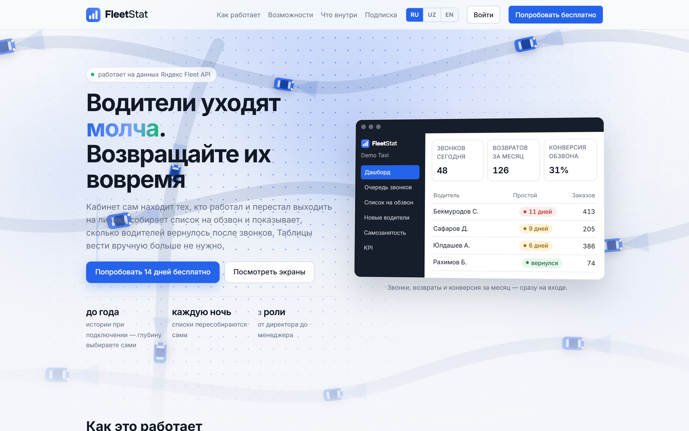
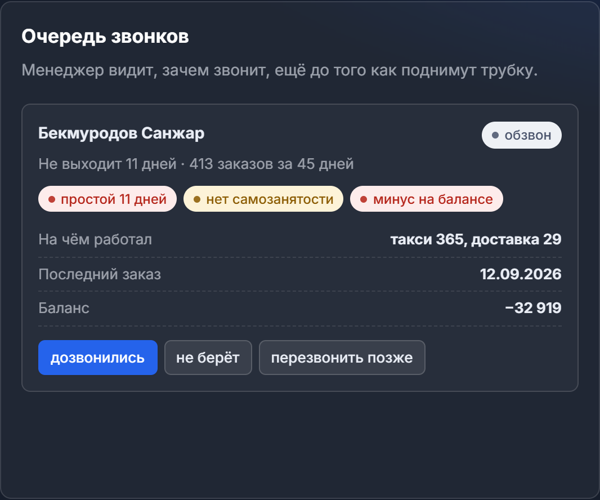
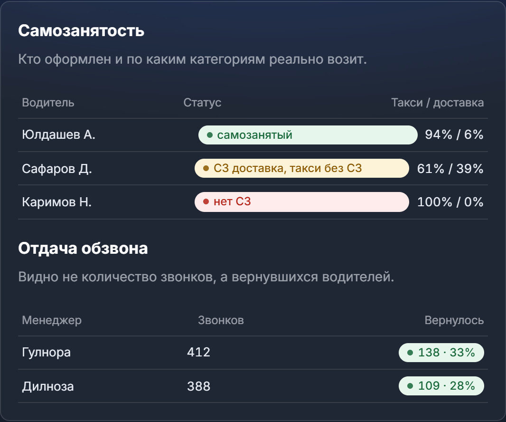

# FleetStat — SaaS-кабинет для таксопарков

**Сайт:** [fleetstat.uz](https://fleetstat.uz) · сентябрь 2026 — н. в.

Веб-сервис для таксопарков Узбекистана, работающих с Яндекс Такси. Сделан по ТЗ заказчика,
работает в продакшене, есть платные тарифы. Кабинет сам находит водителей, которые перестали
выходить на линию, собирает очередь на обзвон и показывает, сколько из них вернулось.

> Исходный код коммерческий и закрыт. Здесь — описание проекта, архитектуры и моих решений.

## Стек

Next.js 16 (App Router, Server Actions), React 19, TypeScript, Prisma 7, PostgreSQL,
Docker Compose, Caddy (автоматический TLS), Linux VPS, GitHub Actions.

## Что сделано

- **Интеграция с Яндекс Fleet API:** заказы, профили водителей, транзакции, условия работы.
  Ночная синхронизация по расписанию, догрузка истории за 45 дней, обработка лимитов API (429) с повторами.
- **Мультиарендность:** несколько таксопарков в одной базе, данные изолированы через Row-Level Security в PostgreSQL.
- **Очередь обзвона:** с ней одновременно работают несколько операторов — водитель закрепляется
  за оператором, обновления приходят в реальном времени через Server-Sent Events.
- **Баланс водителей:** пополнение из кабинета через API Яндекса (лимиты на операцию и на сутки),
  ежедневная сверка с кассой и выпиской, **«Контроль»** — автоматические правила, которые ищут
  подозрительные денежные операции.
- **«Финансы»:** комиссии парка, пополнения и выводы, расходы (в том числе регулярные), касса, экспорт в Excel.
- **Журнал звонков с телефона:** события звонков с Android-телефонов сотрудников склеиваются в звонки,
  и каждый поставленный в кабинете статус сверяется с реальным звонком.
- **Заявки водителей с сайта парка:** приём через API, обзвон, воронка.
- **Безопасность:** роли (директор, менеджер, оператор), двухфакторная авторизация через Telegram,
  защита от подбора пароля, журнал всех действий с IP.
- **Тарифы:** набор разделов зависит от тарифа парка, отдельные функции докупаются.
- **Интерфейс на трёх языках** (RU / UZ / EN) без сторонних библиотек. Публичный лендинг с тарифами, SEO (sitemap, robots).
- **Выкладка:** GitHub Actions — проверка типов, линтер, тесты, сборка и выкладка на сервер
  через SSH-ключ, которому разрешена только одна команда; уведомление о выкладке в Telegram.
- **Проверки:** сценарные проверки через Playwright (права доступа, деньги, очередь звонков,
  вёрстка на трёх языках, попытки атак) и самотест после выкладки.

**Масштаб:** парки на 14,8 тыс. и 42,8 тыс. профилей водителей, около 900 заказов в сутки.

Перенёс сервис на другой хостинг и домен со старых адресов через 301-редиректы.

## Команда

Сервис с нуля и все разделы выше написал я. С октября 2026 к проекту подключились
два разработчика заказчика — для них настроил работу через ветки и Pull Request,
выкладку через GitHub Actions и инструкцию по установке. Сейчас проект развивает команда:
за это время появились Telegram-бот «Новый водитель» (водитель и машина заводятся
в Яндексе по фото документов, распознавание — Claude API), проверка кузовов грузовых машин,
бонусы водителям и отчёт о вернувшихся из оттока.

## Экраны

| Очередь звонков | Самозанятость и отдача обзвона |
|---|---|
|  |  |

Скриншоты — демо-данные с публичной страницы сайта.
